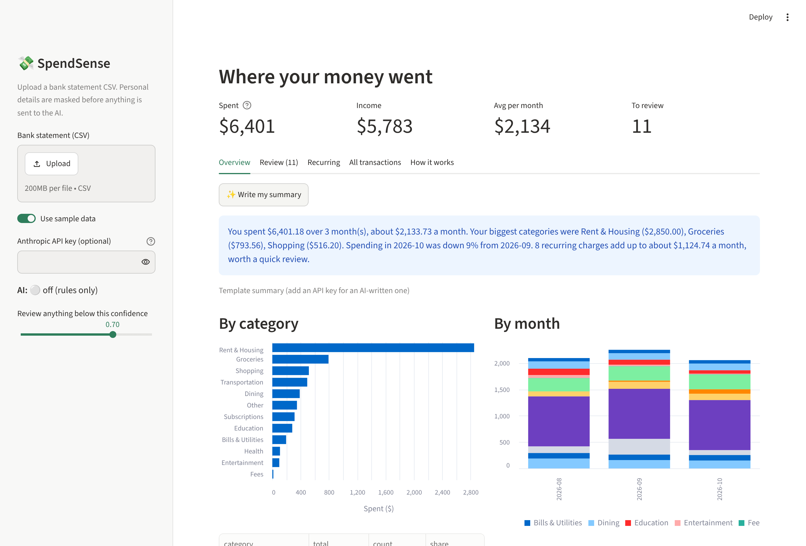

# 💸 SpendSense

**An AI transaction analyst for bank statements.** Upload a CSV export from your bank and SpendSense tells you where your money went: categorized transactions, monthly trends, recurring charges and a plain-language summary.

It's built the way a bank would want an AI feature built: personal information is masked before anything reaches the model, the model's answers are validated against a schema, and anything it isn't sure about goes to a human instead of being guessed.

> **Live demo:** _add your Streamlit Cloud link here_ · Runs on fully synthetic sample data, so no real banking info is ever needed to try it.



## Features

- **Works with real bank exports**: generic `Date, Description, Amount`, debit/credit layouts, and RBC's CSV format
- **Merchant cleanup**: `SQ *TIM HORTONS #4421 TORONTO ON` → `Tim Hortons`
- **Rules-first, AI-second categorization**: known merchants are handled by deterministic rules; only unfamiliar ones go to Claude
- **PII masking**: card and account numbers, emails, phone numbers and e-transfer names are replaced with tags like `[PERSON]` before the AI sees anything
- **Structured, validated outputs**: Claude must return JSON matching a fixed schema (category from a fixed list + confidence 0–1); invalid answers are rejected
- **Human-in-the-loop review**: low-confidence results go to a review queue; one correction applies to every transaction from that merchant
- **Recurring charge detection**: finds subscriptions and bills that repeat monthly at a stable amount
- **AI summary from totals only**: the summary prompt contains aggregated numbers, never individual transactions
- **Graceful fallback**: with no API key (or if the API fails) the app still works, and unknown merchants simply go to review

## How it works

```
CSV ─► parser ─► merchant cleanup ─► rules ──────────────────────────► categorized
                                       │ no match
                                       ▼
                              mask PII ─► Claude (tool-use JSON schema)
                                       ─► Pydantic validation ─► confidence check
                                                                   │ low
                                                                   ▼
                                                             review queue ─► user correction
```

| Design decision | Why |
|---|---|
| Rules before the LLM | Free, instant and deterministic for the obvious majority; the AI only handles what rules can't |
| One AI call per unique merchant, batched | Your weekly coffee shop is categorized once, not 30 times, cutting cost and latency |
| Tool use with a JSON schema | Guarantees machine-readable output instead of free text that has to be parsed and hoped for |
| Pydantic validation + fallback | A hallucinated category or malformed response can't corrupt results or crash the app |
| Confidence threshold | Turns "the model might be wrong" into a visible, reviewable queue |
| Masking before the API call | The model doesn't need anyone's card number or a friend's name to categorize a transaction |

## Run it locally

```bash
git clone https://github.com/<your-username>/spendsense.git
cd spendsense
python -m venv .venv && source .venv/bin/activate   # Windows: .venv\Scripts\activate
pip install -r requirements.txt
streamlit run app.py
```

The app opens with sample data. To turn on the AI, either paste an Anthropic API key in the sidebar or create `.streamlit/secrets.toml`:

```toml
ANTHROPIC_API_KEY = "sk-ant-..."
```

(`secrets.toml` is in `.gitignore`, so your key never gets committed.)

## Evaluation

```bash
python scripts/evaluate.py                       # rules only
ANTHROPIC_API_KEY=sk-ant-... python scripts/evaluate.py   # rules + Claude
```

This reports overall accuracy, how many transactions each layer handled, accuracy per category, and the model's confident mistakes.

**Important:** the included `data/eval_labeled.csv` is a starter set written alongside the rules, so rules-only accuracy on it is optimistic. For an honest number, label ~100 of your own transactions in `data/private/my_labeled.csv` (git-ignored, same two columns) and run `python scripts/evaluate.py data/private/my_labeled.csv`.

## Tests

```bash
pytest -q
```

25 tests, no API key or network needed. A fake client stands in for Claude, and the tests check that:
- PII is masked in what's actually sent to the model
- rule-matched merchants are never sent, and repeat merchants are sent once
- invalid model output (unknown category, bad confidence, missing ids) falls back safely
- an API failure doesn't crash the pipeline
- parsing works for generic, debit/credit and RBC formats

## Deploy (free) on Streamlit Community Cloud

1. Push this repo to GitHub (public).
2. Go to [share.streamlit.io](https://share.streamlit.io), sign in with GitHub, click **Create app**, and pick this repo with `app.py` as the main file.
3. Under **Advanced settings → Secrets**, paste `ANTHROPIC_API_KEY = "sk-ant-..."` if you want the AI on in the demo. (Set a spending limit on your Anthropic account first.)
4. Deploy, then put the link at the top of this README and on your resume.

## Project structure

```
app.py                     Streamlit dashboard
spendsense/
  parser.py                CSV → standard date/description/amount table
  cleaning.py              messy descriptions → clean merchant names
  pii.py                   masks personal info before the AI call
  rules.py                 keyword rules for known merchants
  llm.py                   Claude call, JSON schema, validation, fallback
  pipeline.py              ties it together; confidence + corrections
  analytics.py             category/monthly totals, recurring detection
  summary.py               plain-language summary from totals only
scripts/
  make_sample_data.py      generates the synthetic statement
  evaluate.py              accuracy on the labeled set
tests/                     pytest suite
data/                      sample statement + labeled eval set
```

**Reading order if you're new to the code:** `parser.py` → `cleaning.py` → `rules.py` → `pii.py` → `llm.py` → `pipeline.py` → `app.py`.

## Limitations and next steps

- Rules are keyword-based and tuned for Canadian merchants
- Corrections last for the session only; next step is saving them as new rules so the system learns
- No PDF statements yet (CSV only)
- At bank scale you'd use a privately hosted model rather than an external API, and monitor accuracy over time for drift

## Tech

Python · pandas · Streamlit · Anthropic Claude API (tool use / structured outputs) · Pydantic · pytest
